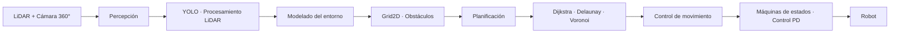

<div align="center">

# 🤖 Robot Navigation Stack

### Navegación robótica modular basada en percepción, planificación y control

**C++23 · RoboComp · Webots · LiDAR · YOLO · Dijkstra · Grid2D**

</div>

---

## Descripción

**Robot Navigation Stack** es un proyecto de robótica móvil desarrollado sobre **RoboComp** y **Webots** cuyo objetivo es construir, de forma progresiva, un sistema capaz de percibir su entorno, seguir objetivos, evitar obstáculos y calcular rutas seguras en escenarios dinámicos.

El proyecto evoluciona desde comportamientos reactivos basados en máquinas de estados hasta una arquitectura modular con **representación del entorno en rejilla, percepción mediante LiDAR y visión, planificación de rutas y control de movimiento**.

---

## Arquitectura



La arquitectura separa las responsabilidades de percepción, representación del entorno, planificación y control, facilitando la evolución del sistema y la integración de nuevas estrategias.

---

# Evolución del proyecto

## 01 · Coverage Navigation

Primer sistema de navegación autónoma orientado a maximizar la superficie recorrida en un entorno simulado.

**Principales elementos:**
- Navegación basada en una **máquina de estados**.
- Estados `FORWARD`, `TURN`, `FOLLOW_WALL` y `SPIRAL`.
- Detección de obstáculos mediante **LiDAR**.
- Seguimiento de paredes.
- Estrategias de exploración y cobertura.
- Evaluación sobre distintos escenarios de Webots.

La mejor ejecución documentada alcanzó un **60,5 % de cobertura** dentro del tiempo de prueba.

---

## 02 · Person Tracking

Evolución del sistema para realizar seguimiento de personas en tiempo real.

**Principales elementos:**
- Detección de personas mediante **YOLO**.
- Cámara omnidireccional de **360°**.
- Integración de datos procedentes de sensores LiDAR.
- Gestión de datos asíncronos mediante **DoubleBuffer**.
- Control de distancia y orientación respecto al objetivo.
- Máquina de estados con `SEARCH`, `TRACK`, `WAIT`, `TURN` y `STOP`.
- Modulación de velocidad para reducir oscilaciones y mantener un seguimiento estable.

Tras el ajuste del controlador, el robot consiguió completar **10 vueltas siguiendo al objetivo sin colisiones** en el escenario de evaluación.

---

## 03 · Geometric Obstacle Avoidance

Incorporación de técnicas geométricas para representar obstáculos y calcular trayectorias seguras.

**Procesamiento del entorno:**
- Extracción de líneas mediante **Transformada de Hough**.
- Filtrado de puntos próximos a paredes.
- Agrupación de puntos mediante **DBSCAN**.
- Generación y expansión de polígonos de obstáculos.
- Transformación de segmentos de pared en regiones ocupadas.

**Planificación:**
- **Triangulación de Delaunay**.
- Construcción de **diagramas de Voronoi**.
- Creación de un grafo de espacio libre.
- Cálculo de rutas mediante **Dijkstra**.
- Suavizado y discretización de trayectorias.
- Seguimiento mediante un controlador proporcional/derivativo.

---

## 04 · Grid-Based Path Planning

La última evolución sustituye parte de la navegación reactiva por una representación explícita y actualizable del entorno.

### Grid2D

El entorno se discretiza mediante una rejilla de **100 × 100 celdas**, donde cada celda representa una región de `100 mm × 100 mm` y puede encontrarse en uno de tres estados:

```text
FREE      → espacio navegable
OCCUPIED  → obstáculo detectado
UNKNOWN   → estado no determinado
```

La rejilla se actualiza dinámicamente utilizando los datos del LiDAR.

### Componentes

El sistema se divide principalmente en:

```text
┌─────────────────────────┐
│   ObsPersonTracker      │
│                         │
│  YOLO · LiDAR · Target  │
└────────────┬────────────┘
             │
             │ getPaths(source, target)
             ▼
┌─────────────────────────┐
│      Grid2D Planner     │
│                         │
│ Grid · Dijkstra · Path  │
└────────────┬────────────┘
             │
             ▼
       Motion Controller
```

Esta separación permite desacoplar la percepción y el seguimiento del objetivo de la lógica de planificación.

### Robustez y concurrencia

Durante el desarrollo se abordaron problemas relacionados con:

- acceso concurrente a la representación del entorno;
- sincronización entre actualizaciones de la rejilla y solicitudes de rutas;
- obstáculos dinámicos;
- rutas no alcanzables;
- recálculo de trayectorias;
- estados de seguridad cuando no existe un camino válido.

Para mantener la consistencia de los datos se utilizaron mecanismos como **mutexes** y **double buffering**.

---

# Stack tecnológico

| Área | Tecnologías |
|---|---|
| **Lenguaje** | C++23 |
| **Robótica** | RoboComp |
| **Simulación** | Webots |
| **Sistema** | Ubuntu 22.04 |
| **Build** | CMake |
| **Percepción** | LiDAR · Cámara 360° · YOLO |
| **Procesamiento** | Hough Transform · DBSCAN |
| **Geometría** | Delaunay · Voronoi |
| **Planificación** | Dijkstra · Grid2D |
| **Control** | Máquinas de estados · Control proporcional / PD |
| **Concurrencia** | Mutexes · DoubleBuffer |
| **Desarrollo** | Git · GitHub · CLion |

---

# Estructura del repositorio

```text
robot-navigation-stack/
│
├── 01-coverage-navigation/
│   └── navegación reactiva y cobertura del entorno
│
├── 02-person-tracking/
│   └── seguimiento de personas mediante visión y LiDAR
│
├── 03-geometric-obstacle-avoidance/
│   └── representación geométrica y planificación de rutas
│
└── 04-grid-based-path-planning/
    └── Grid2D, planificación dinámica y control
```

---

# Principales conceptos aplicados

- Robótica móvil.
- Arquitectura software basada en componentes.
- Procesamiento de datos LiDAR.
- Visión artificial y detección de objetos.
- Máquinas de estados.
- Navegación reactiva.
- Representación del entorno.
- Clustering y geometría computacional.
- Algoritmos de caminos mínimos.
- Planificación de trayectorias.
- Control de movimiento.
- Concurrencia y sincronización.
- Diseño modular y reutilización de componentes.

---

# Documentación técnica

El proyecto cuenta con una memoria técnica completa en formato IEEE que documenta:

- arquitectura del sistema;
- fundamentos matemáticos;
- algoritmos utilizados;
- evolución entre las distintas fases;
- escenarios de simulación;
- resultados obtenidos;
- limitaciones detectadas y posibles mejoras.

La documentación se incorporará al repositorio dentro de `docs/`.

---

## Autores

Proyecto académico desarrollado en la **Escuela Politécnica de Cáceres — Universidad de Extremadura**.

- Ismael Díaz Romero
- José Javier Pérez Sánchez
- Sergio Jiménez Macías

---

<div align="center">

### Universidad de Extremadura · Ingeniería Informática — Ingeniería de Computadores

</div>
